<div align="center">
  <picture>
    <source media="(prefers-color-scheme: dark)" srcset="assets/branding/logo-xm-white.svg">
    <source media="(prefers-color-scheme: light)" srcset="assets/branding/logo-xm.svg">
    
  </picture>
</div>

# xmark-manager

A cross-browser (Firefox, Chrome, Safari; Manifest V3) extension that saves X posts into folders you control.

> **Early beta.** xmark-manager is still early. For now you can install it from source by following [docs/INSTALL.md](docs/INSTALL.md) (Firefox, Chrome and Safari). It will soon be available on the official Firefox Add-ons site.

## Why

X's own bookmark folders are only available with a paid subscription. xmark-manager gives you the same kind of organisation for free: save any post into a folder, add tags and a note, then search and filter your library later. Everything is stored locally in your browser, with export and import for backups, so there is no account and no server involved.

- Create, rename and delete your own folders; move posts between them at any time.
- Tag posts and add notes, then search and filter by folder or tag.
- Save from the XM button on a post, or from the toolbar popup.
- Private by design: no network requests, no telemetry, and nothing read from X except the one post you choose to save.

Project status and what to do next: [docs/PROJECT_STATUS.md](docs/PROJECT_STATUS.md).

[](https://github.com/Abhinavlvs/xmark-manager/actions/workflows/ci.yml)
[](https://github.com/Abhinavlvs/xmark-manager/actions/workflows/codeql.yml)
[](https://scorecard.dev/viewer/?uri=github.com/Abhinavlvs/xmark-manager)
[](LICENSE)
[](https://github.com/Abhinavlvs/xmark-manager/releases)
[](docs/INSTALL.md)
[](CONTRIBUTING.md)

- No runtime dependencies: plain JavaScript ES modules. A zero-dependency script assembles the per-browser bundles (`npm run build`).
- Phase 1 is local-only: your data stays in your browser and the extension makes no network requests. Export and import move your library between browsers.
- Options page: Saved (the whole library on one roomy page), folders, export/import/delete-all, the text-snippet privacy toggle and its length (35 to 280 characters, default 280), host access and about.
- Minimal permissions: `storage`, `activeTab`, and access to `x.com` / `twitter.com`.

## Using it

- Save from a post on X: click the XM button in the post's action bar to open the Save panel, pick a folder, add tags and a note, press Save. The panel's last Folder choice, "Add folder…", opens Options > Folders in a new tab (nothing is created or saved by choosing it); create the folder there, go back to X and open Save again. Anything typed in the panel is not kept.
- Save from the toolbar: open a post page and click the toolbar icon, then use the popup's Save tab. You can create folders there ("New folder…") or in Options > Folders; folders are never created from x.com itself.
- Browse: the popup's Saved tab is for quick lookups. For the whole library on a roomy page open Options (the gear in the popup, or the extension's options), which lands on **Saved**: search, sort (newest, oldest, author), filter by folder and tag, and Edit, Move or Delete (with Undo). It shows 50 posts at a time with "Show more", and refreshes when you come back to the page after saving something elsewhere.
- Options sections: Saved, Folders (add, rename, delete), Data (export, import with a preview, delete all, unreadable-data copies), Privacy (text-snippet toggle and snippet length), Permissions (Enable on X) and About.

## Screenshots

Every screenshot is 1280x800. The first two are real captures of x.com in Firefox (a public post). Every other shot uses invented data (fictional handles and text). See [docs/SCREENSHOTS.md](docs/SCREENSHOTS.md) for how they are made.

### On x.com

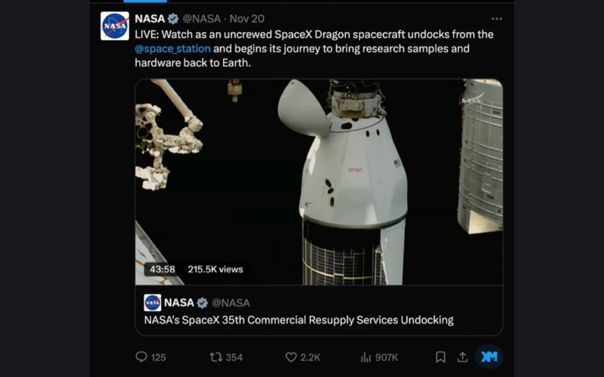
The XM button next to bookmark and share on a real post on x.com (public post by NASA, captured in Firefox).

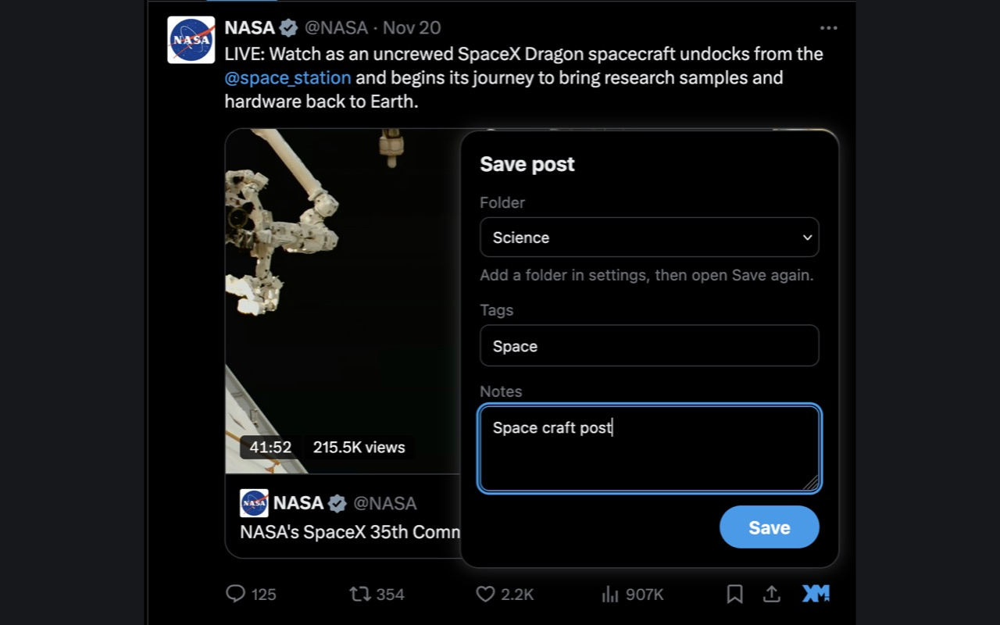
The save panel on the same post.

### Options

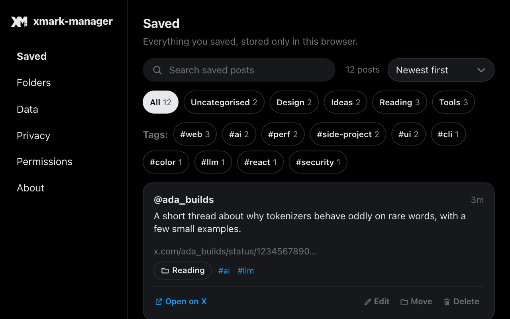
Saved: the whole library on one page, with search, sort, folder and tag filters, 50 posts at a time, and the same Edit, Move and Delete (with Undo) as the popup.

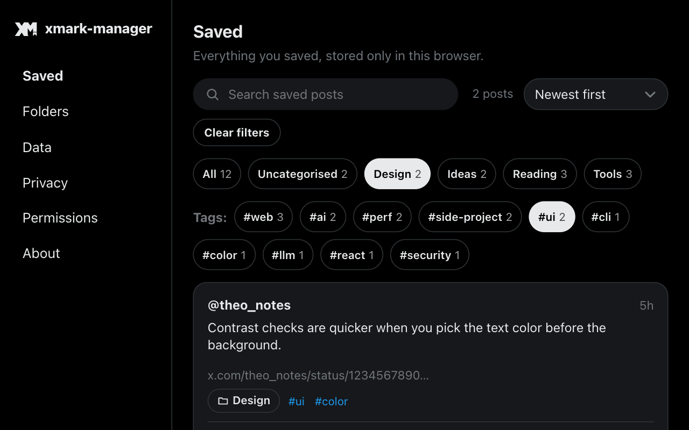
A folder and a tag filter active at the same time.

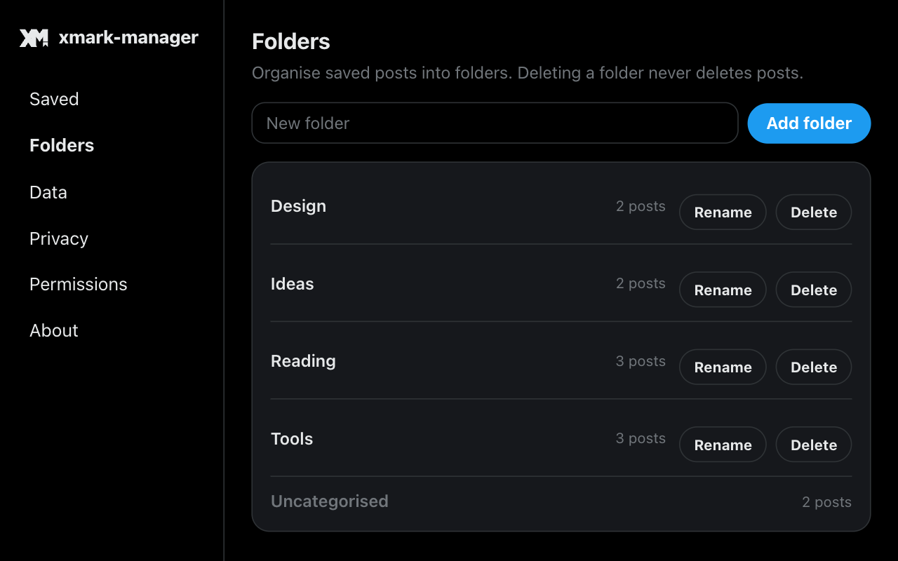
Folders: add, rename and delete.

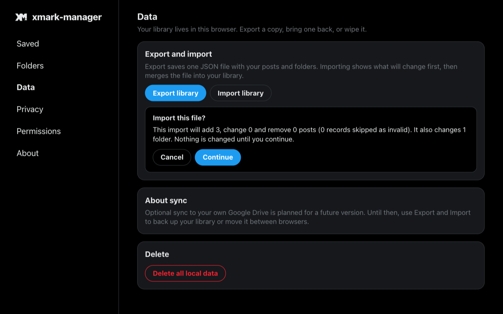
Data: export, import with a preview before anything changes, and delete all.

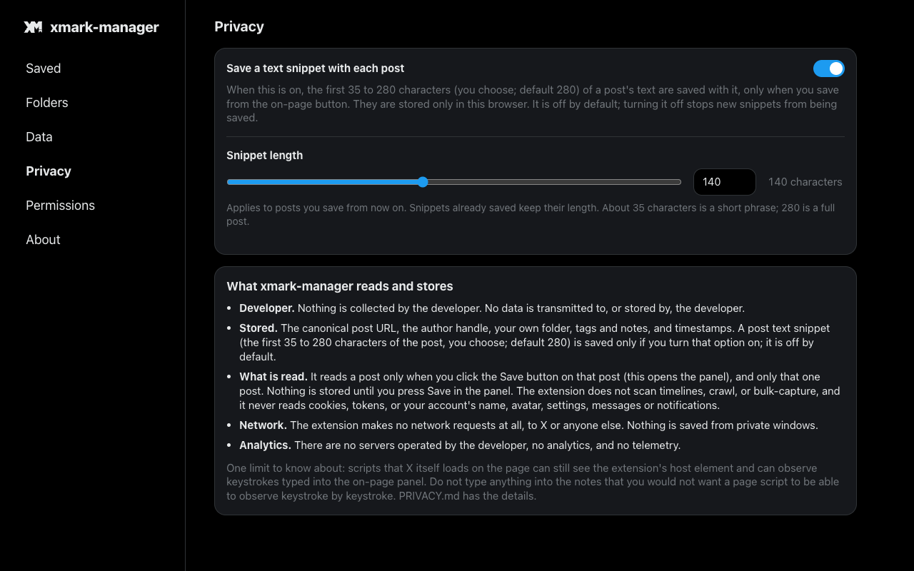
Privacy: the text-snippet toggle, the snippet length control (35 to 280 characters) and what is read and stored.

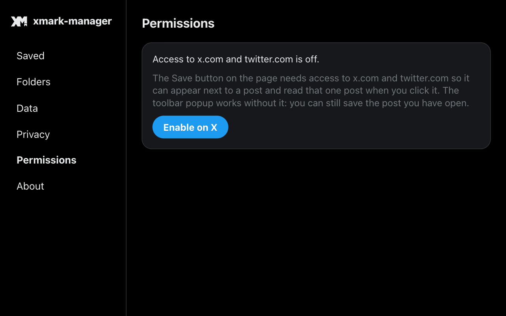
The permissions the extension holds and the host access state.

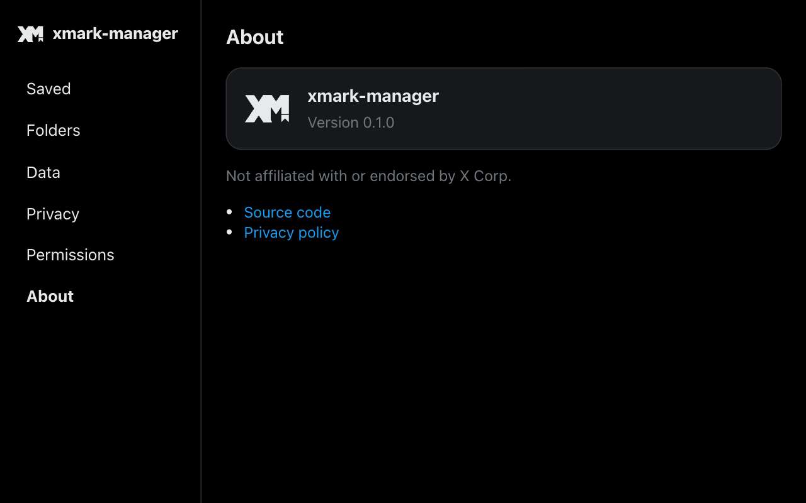
Version and project information.

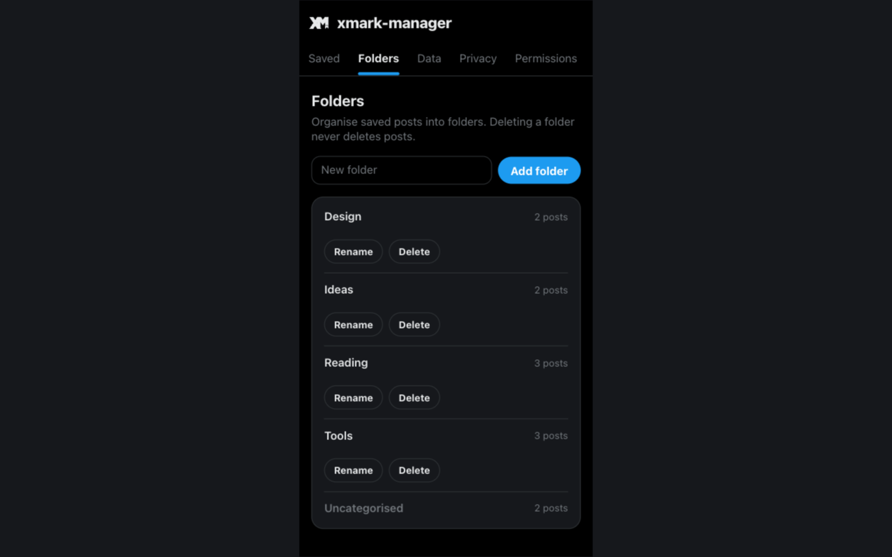
The options page at 390 px wide.

### Popup

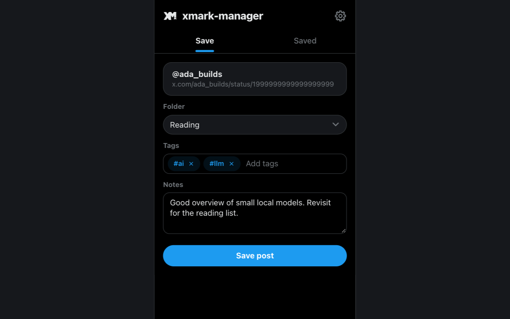
Save tab: pick a folder, add tags and a note, then save the post.

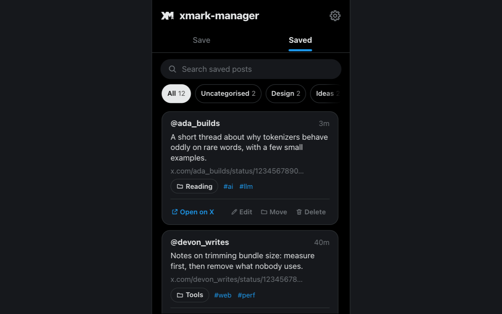
Saved tab: search, folder chips and post cards.

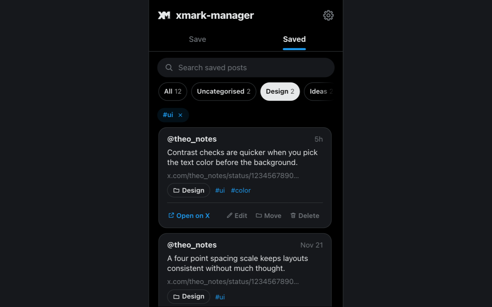
Filter by folder and tag together.

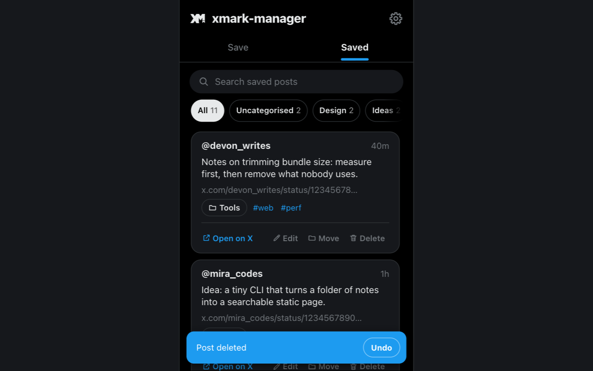
Deleting a post shows an Undo snackbar.

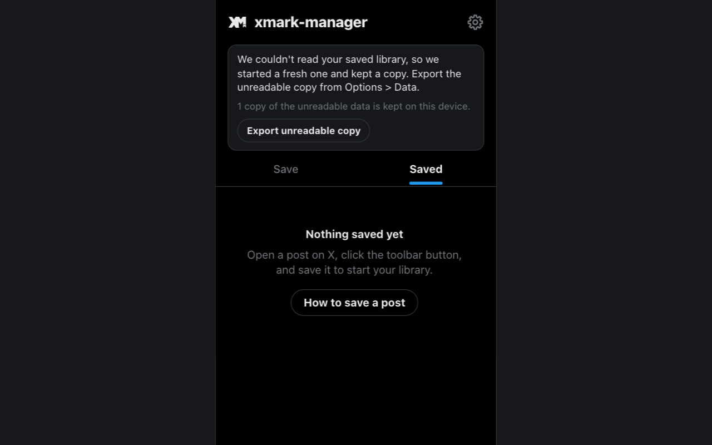
Unreadable library notice: a fresh library is started and the old data is kept as a copy you can export.

## Supported browsers

| Browser | Minimum version   | Bundle         | Notes                                                                                                    |
| ------- | ----------------- | -------------- | -------------------------------------------------------------------------------------------------------- |
| Firefox | 140 (Android 142) | `dist/firefox` | Background scripts, SVG icons with light/dark toolbar variants.                                          |
| Chrome  | 98                | `dist/chrome`  | Service-worker background, PNG app icons (white monogram on black, readable on light and dark toolbars). |
| Safari  | 18.0              | `dist/safari`  | Background scripts, PNG icons, black template-style toolbar icon. UNVERIFIED on a real device.           |

Why Chrome 98: it is the highest "first supported" version over everything the shipped code needs (MDN browser-compat-data v8.1.10):

- Manifest keys: module service workers (`background.type`) 92; `action`, `host_permissions`, `background.service_worker` 88; `incognito: "not_allowed"` 47; `options_ui` 40.
- Extension APIs: all older (`storage.local` 19, `permissions` 16, `tabs` incognito flag 16). Promise forms (`runtime.sendMessage` promises, Chrome 99) are not needed: on Chrome without a `browser` namespace the adapter uses callbacks.
- JS built-ins and syntax: `structuredClone` 98 (the maximum; every repository operation), `Object.hasOwn` 93, `Array.prototype.at` 92, `crypto.randomUUID` 92, `?.` / `??` 80, CSS `:focus-visible` 86. `scrollbar-width`/`scrollbar-color` (Chrome 121) is progressive enhancement with a `::-webkit-scrollbar` fallback and is excluded.

`tests/browser-floor.test.js` scans `src/` against a feature table and fails if the declared floor and the code disagree. The same table shows everything used is available in Firefox 140 and Safari 18 (newest requirement: Firefox 95, Safari 15.4). Safari 18.0 is a project choice, not a technical floor (that is 16.4, module background scripts); Firefox 140 comes from the manifest.

Node.js 20 or newer is needed for development only. Install from source (step by step for Firefox, Chrome and Safari: [docs/INSTALL.md](docs/INSTALL.md)):

- **Firefox**: `npm ci && npm run run` (temporary profile), or `npm run build:firefox` then open `about:debugging#/runtime/this-firefox`, "Load Temporary Add-on...", and pick `dist/firefox/manifest.json`.
- **Chrome**: `npm ci && npm run build:chrome`, open `chrome://extensions`, switch on "Developer mode", "Load unpacked", and pick `dist/chrome`.
- **Safari (builds; not yet run in Safari by the maintainers)**: on a Mac with Xcode, `npm ci && npm run safari:convert && npm run safari:build`, then follow [docs/SAFARI.md](docs/SAFARI.md) to run it locally (signing, "Allow unsigned extensions", website access) and for what is verified and what is not.

### Private windows

- Firefox and Chrome do not run the extension in private windows at all (manifest `incognito: "not_allowed"`; Chrome docs: "The extension cannot be enabled in incognito mode", available from Chrome 47).
- Safari does not support `incognito: "not_allowed"` (MDN browser-compat-data, webkit.org/b/280785), so the user may allow the extension in private windows. Saves are still meant to be refused by the extension's own checks (not yet verified on Safari: neither value below has been observed on a device): the popup sends the private flag of the active tab (`tabs.query` returns `incognito` without the `tabs` permission), the content script's messages carry `sender.tab.incognito`, and the background rejects `SAVE_POST` for either. Safari reports `extension.inIncognitoContext` as `false` in extension pages, which is why the tab flag is used.

### Chrome

- Install from source: `npm ci && npm run build:chrome`, then `chrome://extensions` > "Developer mode" > "Load unpacked" > `dist/chrome`. Minimum version 98 (see above). Chrome grants the `x.com` and `twitter.com` access at install; there is no Chrome Web Store listing yet.
- Tested in real Chromium: `npm run e2e:chrome` and `npm run e2e:chrome:persistence` load `dist/chrome` unpacked into Chrome for Testing 158 (macOS arm64, headless) and check, with real Chrome message senders: the load (no manifest errors or warnings), popup and options pages, saving and listing through the service worker, the message guard, content-script injection and a trusted-click save on a local copy of the fixture (never the real x.com), that the extension is inactive in an off-the-record context and that Chrome offers no way to enable it there (the `not_allowed` key is shown to matter by a mutation run), service-worker stop and restart, permissions, and a clean quit and relaunch on the same profile (library, settings, tombstones, unreadable-library copies). Details and limits: [scripts/e2e/README.md](scripts/e2e/README.md).
- Not tested: branded Google Chrome (branded Chrome 137+ ignores the command-line load switch the script uses, so the unpacked "Load unpacked" path is for you to run: [docs/MANUAL_QA.md](docs/MANUAL_QA.md) Part B), a Chrome Web Store install, Windows and Linux, the real x.com markup, and toolbar icons on light and dark themes.

## Development

```sh
npm ci
npm test          # unit tests
npm run lint      # eslint + prettier check
npm run build       # bundles for Firefox, Chrome and Safari into dist/<browser>/
npm run build:lint  # build the Firefox bundle and run web-ext lint on it
npm run run       # launch Firefox with the extension loaded
npm run package     # build all bundles and zip each into dist/zips/
npm run dev         # dev harness at http://127.0.0.1:5173/dev/popup.html, /dev/options.html, /dev/x-fixture.html
```

Real-browser checks (not part of `npm test`; each prints SKIP when its tool is missing): `npm run e2e:firefox` and `npm run e2e:persistence` need `GECKODRIVER_BIN`; `npm run e2e:chrome` and `npm run e2e:chrome:persistence` need `CHROME_BIN` (Chrome for Testing or Chromium). See [scripts/e2e/README.md](scripts/e2e/README.md). Contributor and AI-assistant rules: [CLAUDE.md](CLAUDE.md).

## Where your data lives

Your library is kept in `browser.storage.local`: durable extension storage inside your Firefox profile. It survives page reloads, browser restarts and reboots, and is removed only when you uninstall the add-on or choose "Delete all local data". It is not the HTTP cache and not a web page's `localStorage`, so clearing cookies or site data does not touch it. Every change is written as one atomic update, one at a time.

An unreadable library is never overwritten without a copy of exactly that value. If the stored library cannot be read (corrupt, or written by a newer version), the app starts with an empty library, and before anything is saved it keeps the unreadable value as a copy on the device. If only some records are unreadable, the rest stays usable, those records are left out, and the whole original value is kept as a copy. Each distinct unreadable value gets its own copy (at most 5; a sixth is not written and saving stays refused until you discard one; exporting does not free a slot). If a copy cannot be written, saving is refused and the app says so. A notice shows how many copies exist; Options > Data lists them with Export and Discard, and when the current value has no copy (all 5 slots used) it offers "Export current unreadable value". Every copy has its own id and a request to export or discard names both the number and the id, so a page showing an old list can never act on a newer copy that reused the number (it is told "That copy changed" and refreshes). Exported copies are named `xmark-unreadable-copy-<n>-<id prefix>.txt`. Any value found under a copy key is kept as a copy, so five junk values fill all five slots and you must discard them to make room. Discarding never touches your current library, and if the library is still unreadable it is copied again. "Delete all local data" keeps the copies unless you tick the box to delete them too.

## Backup and restore

- Options > Data > Export saves one JSON file (`version`, `exported_at`, folders, posts). Import shows what will change first, then merges the file into the library; delete-all followed by an import of your export restores everything exactly.
- A post is identified by its X status id, so `x.com/Alice/status/1`, `twitter.com/alice/status/1` and `/i/web/status/1` are one post. If merge or import meets several records for one status, last writer wins among those that know a handle (the stored link keeps the newest handle casing; a newer `/i/web/` duplicate loses to a record with a handle). The losers become tombstones and their notes, tags and folder are dropped, not combined.
- Import timestamps: a record may not claim to be newer than the file itself. When the file has a valid `exported_at` that is not in the future, later `updated_at` values are clamped to it, so importing the same file again gives the same result every time, and normal last-writer-wins applies against your library. When the file has no valid `exported_at`, or it is in the future (a clock running ahead), a future-dated record cannot prove it is newer: if it differs from the record you already have with the same id, your record is kept (the result says how many posts and folders were kept as they are on this device; the same goes for a record with another id but the same status as a post you have), and it never replaces edits you made after an earlier import. New posts and records identical to yours import normally.
- If a save fails (for example the storage is full) you see "Couldn't save" and nothing is changed; export a backup and delete old posts. A failed read says "Couldn't read your library" instead.

## Limits

- Firefox gives `storage.local` the same limits as IndexedDB: per MDN, the smaller of 10% of the disk holding the profile or 10 GiB per site group. The `unlimitedStorage` permission is not requested and is not needed at this scale.
- Measured with a synthetic 10,000-post library (typical snippet, tags and notes): about 2.8 MB serialized, and one save takes roughly 100 ms. That cost is the whole document being rewritten each time plus the re-read and validation of the stored value that `save()` does first to protect unreadable data. So 10,000 posts is far below the quota; if storage is ever full, the save is refused with a clear message and Export is the way out.
- Import files are limited to 25 MB.

## Before release

- Done: the permanent Firefox add-on id is `{6c820dd8-f422-43e5-bb44-e392b7fac38a}` (`src/manifest.json`); never change it. Done: version 0.1.0, privacy policy, support and homepage URLs, release date, and 1280x800 screenshots.
- Open: manual QA on real Firefox and x.com, then the store submission. The full list and the remaining engineering backlog are in [docs/PROJECT_STATUS.md](docs/PROJECT_STATUS.md).
- Revisit `data_collection_permissions` in the manifest.

## Releasing

Maintainers: see [docs/RELEASING.md](docs/RELEASING.md) (`npm run release:dry-run`, the release and store deployment workflows, checksums and provenance).

## Roadmap: Phase 2

Optional sync to your own Google Drive is planned, not built (nothing in this version uses the network). Design: `drive.file` scope only (the extension sees just files it created), one JSON file, an explicit consent screen before the first connect, and controls to disconnect and delete the Drive copy. Until then, Export and Import in the options page cover backup and moving between browsers.

## Known limitations / verification needed

- The Safari bundle builds but has never been run in Safari. Real-device checks for Safari are still open (Task C3): private-tab flags, the Safari install steps, the toolbar icon tinting.
- The message guard is built from `runtime.getURL('')` and throws at service-worker start if that value has an unexpected shape (it must look like `<scheme>-extension://<id>/`). This fails closed but would take down all messaging; check it on each browser during device testing.

## Privacy

See [PRIVACY.md](PRIVACY.md).

## Contributing

See [CONTRIBUTING.md](CONTRIBUTING.md). Please follow the [Code of Conduct](CODE_OF_CONDUCT.md).

## License

[MIT](LICENSE)

## Logo and trademarks

The logo (`assets/branding/logo-xm.svg`) is an original XM monogram created for this project. It is not derived from any company's logo. xmark-manager is not affiliated with or endorsed by X Corp. "X" is a trademark of X Corp.

## Disclaimer

xmark-manager is not affiliated with or endorsed by X Corp. "X" is a trademark of its owner. The extension only organizes links the user chooses to save.
